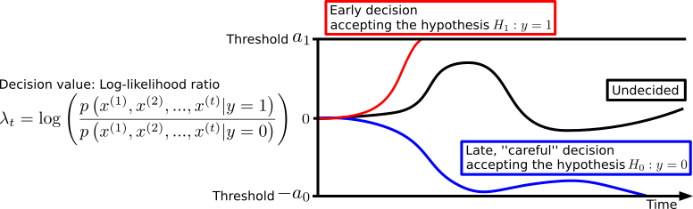
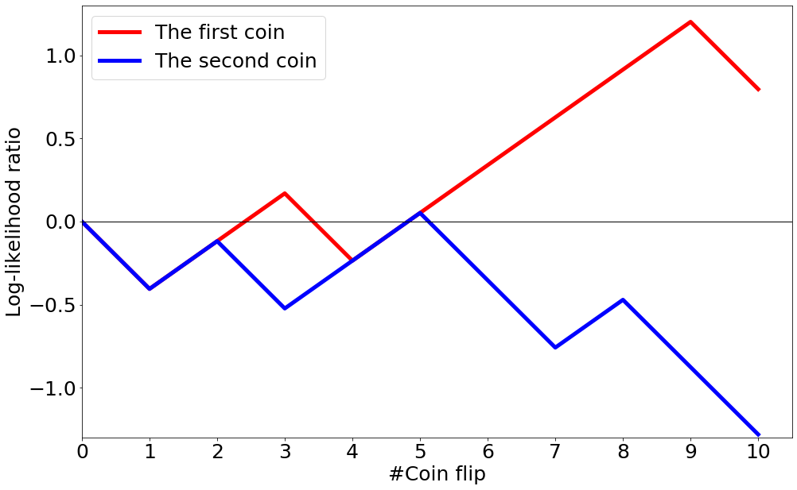
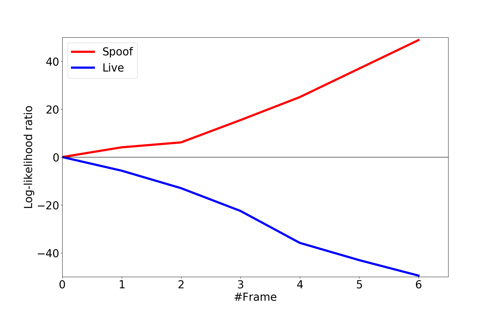
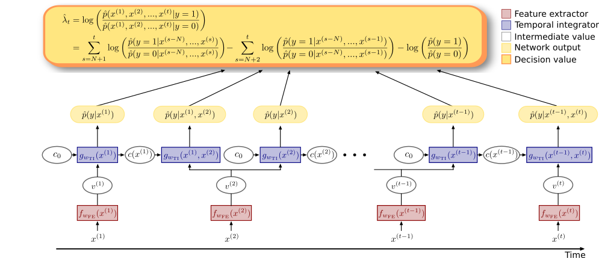
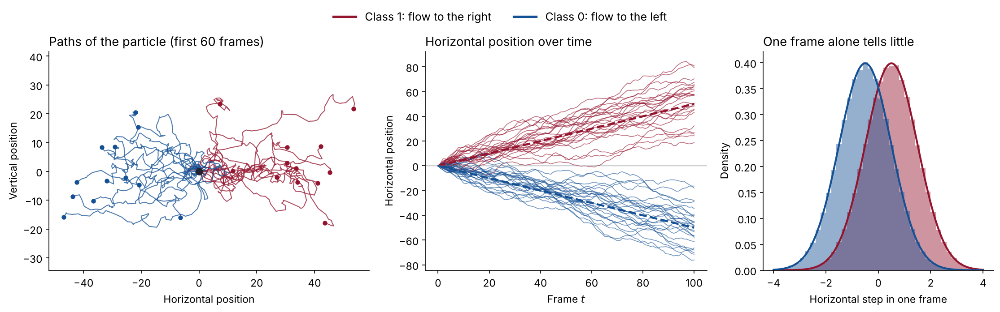
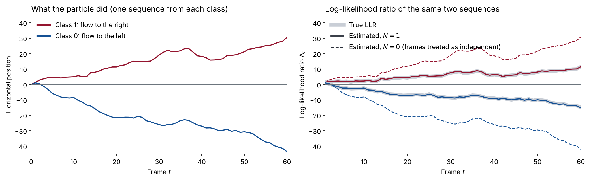
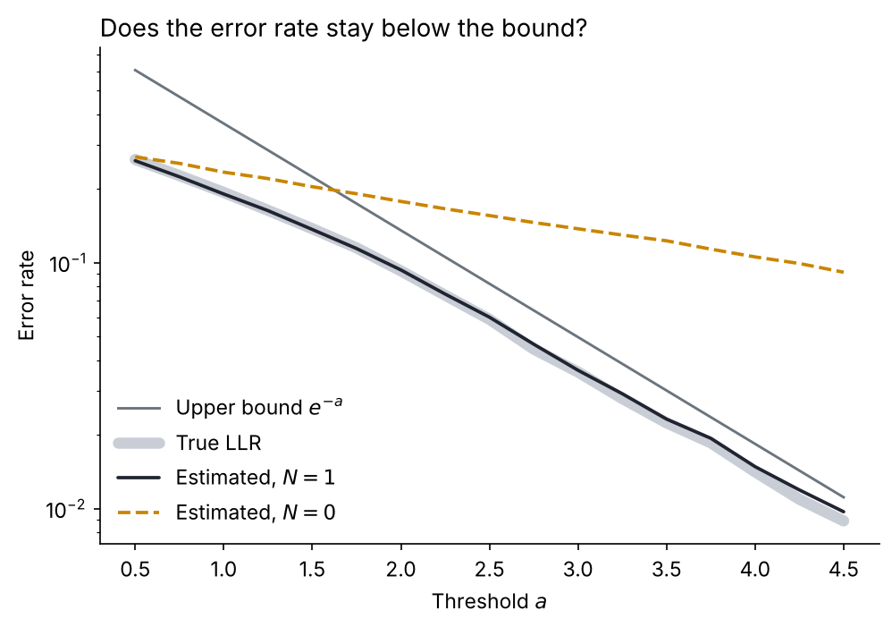
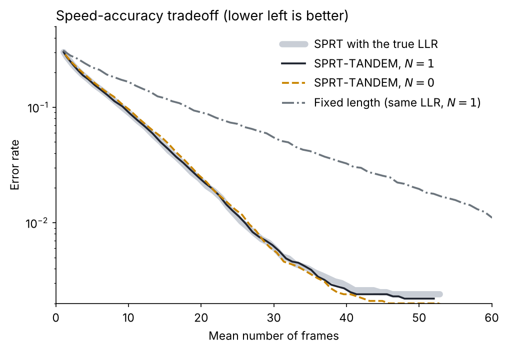

# SPRT-TANDEM tutorial

[](https://colab.research.google.com/github/Akinori-F-Ebihara/SPRT-TANDEM-tutorial/blob/main/SPRT_TANDEM_tutorial_PyTorch.ipynb)

In this tutorial, we show you how to train & evaluate the __SPRT-TANDEM__ algorithm on a sequential dataset. The tutorial is designed to work on [Google Colab](https://colab.research.google.com/).  

<!-- If you wish to use __SPRT-TANDEM__ for your custom project, [PyTorch](https://github.com/Akinori-F-Ebihara/SPRT-TANDEM-PyTorch) and [TensorFlow](https://github.com/TaikiMiyagawa/MSPRT-TANDEM) implementations are available. -->

<!-- This tutorial uses a small synthetic dataset, so that the whole notebook runs on a CPU in about one minute and the estimated log-likelihood ratio can be checked against the true one (see [Example 3](#example-3-a-particle-carried-by-a-flow) below). The previous version of the tutorial, written in TensorFlow, is kept [here](https://github.com/Akinori-F-Ebihara/SPRT-TANDEM_tutorial_tensorflow). -->

## Quickstart

1. Click [this link](https://colab.research.google.com/github/Akinori-F-Ebihara/SPRT-TANDEM-tutorial/blob/main/SPRT_TANDEM_tutorial_PyTorch.ipynb) to open the following notebook in Google Colab:  
   [``./SPRT_TANDEM_tutorial_PyTorch.ipynb``](https://github.com/Akinori-F-Ebihara/SPRT-TANDEM-tutorial/blob/main/SPRT_TANDEM_tutorial_PyTorch.ipynb)
2. Follow the instruction in the notebook!

The notebook can be executed on your own machine as well. It needs NumPy, Matplotlib, and PyTorch, and no GPU is required:

```
git clone https://github.com/Akinorfi-F-Ebihara/SPRT-TANDEM-tutorial.git
cd SPRT-TANDEM-tutorial
pip install numpy matplotlib torch jupyterlab
jupyter lab SPRT_TANDEM_tutorial_PyTorch.ipynb
```

The notebook has been tested with Python 3.11–3.13, PyTorch 2.2–2.15, NumPy 1.26–2.5, and Matplotlib 3.8–3.11.

# SPRT-TANDEM: what is it?

## Introduction
__SPRT-TANDEM__ is a sequential density ratio estimation algorithm originally proposed in the paper, ["Sequential Density Ratio Estimation for Simultaneous Optimization of Speed and Accuracy"](https://openreview.net/forum?id=Rhsu5qD36cL) [ICLR2021 Spotlight]. The __SPRT-TANDEM__ sequentially estimates log-likelihood ratios of two hypotheses, or classes, for fast and accurate sequential data classification. 

The original paper [1] can be found [here,](https://arxiv.org/abs/2006.05587) and PyTorch implementation can be found [here.](https://github.com/Akinori-F-Ebihara/SPRT-TANDEM-PyTorch) While the technical details are left to the paper, we provide a casual introduction to our algorithm below.


## Problem setting
Imagine you have a sequential data,  

```math
X^{(1,T)} := \lbrace x^{(1)}, x^{(2)}, ..., x^{(t)}, ..., x^{(T)} \rbrace,
```

where $x^{(t)}$ is a data sample, such as a video frame, an audio signal, a neural firing rate, etc. The sequential data $X^{(1,T)}$ has an associated binary label $y\in\lbrace1,0\rbrace$ that indicates a class to which the sequential data belong. Your task is to correctly estimate the class label $y$, with a minimal number of data samples possible (say, $k < T$ samples). Generally speaking, there is a trade-off between speed (i.e., small data samples) and accuracy (i.e., a correct estimate of the label): using fewer samples tends to increase the misclassification rate, while highly accurate classification requires more data samples. Thus, it is a non-trivial problem.

## Sequential Probability Ratio Test
One algorithm that provides a solution to the above tradeoff problem is the Sequential Probability Ratio Test, or SPRT, which was originally invented by Abraham Wald [5, 6]. The SPRT calculates the log-likelihood ratio (LLR) of two competing hypotheses (i.e., $y=1$ vs. $y=0$) and updates the LLR every time a new sample is acquired until the LLR reaches one of the two thresholds for alternative hypotheses.

<div align="center">

</div>

As the schematic figure above shows, for data that is easy to classify, the SPRT outputs an answer taking a few samples, whereas, for difficult data, the SPRT takes in numerous samples in order to make a "careful" decision. Importantly, Wald and his colleagues proved that when sequential data are sampled from independently and identically distributed (i.i.d.) data, SPRT can minimize the required number of samples to achieve the desired upper-bounds of false positive and false negative rates comparably to the Neyman-Pearson test, known as the most powerful likelihood test [4, 6].  

Thus, we would like to use the SPRT whenever possible for solving the sequential classification problem. Below we will see how the SPRT can be applied to a real problem.

## Example 1: coin flipping
Let's start with a toy example to get the hang of the SPRT.  

<div align="center">

</div>

You have two coins, but one of them is a skewed coin that has uneven probabilities of generating head or tail when it is flipped:

```math
\text{Unbiased coin: } y=0 \;
\begin{cases}
  p(x^{(t)} | y=0) = \frac{1}{2} & \text{if } x^{(t)} = x_{head} \\
  p(x^{(t)} | y=0) = \frac{1}{2} & \text{if } x^{(t)} = x_{tail}
\end{cases}
```

```math
\text{Biased coin: } y=1 \;
\begin{cases}
  p(x^{(t)}| y=1) = \frac{1}{3} & \text{if } x^{(t)} = x_{head} \\
  p(x^{(t)}| y=1) = \frac{2}{3} & \text{if } x^{(t)} = x_{tail}
\end{cases}
```

You do not know which one is biased: the true labels $y$ of the coins are unknown. Now, you want to experiment with the two coins to make a guess on the labels. Thus, the two hypotheses are:  

```math
\begin{aligned}
    &H_0: y=0 \text{   (It is the unbiased coin.)} \\
    &H_1: y=1 \text{   (It is the biased coin.)}
\end{aligned}
```

Flipping each of them ten times yields the following results. Note that we assume each flipping trial is independent.

The first coin:

```math
X_{1}^{(1, 10)} = \lbrace x_{head}, x_{tail}, x_{tail}, x_{head}, x_{tail}, x_{tail}, x_{tail}, x_{tail}, x_{tail}, x_{head} \rbrace
```

The second coin:

```math
X_{2}^{(1, 10)} = \lbrace x_{head}, x_{tail}, x_{head}, x_{tail}, x_{tail}, x_{head}, x_{head}, x_{tail}, x_{head}, x_{head} \rbrace
```

In order to use the SPRT for testing hypotheses, you need to calculate the LLR. Luckily, in this example you can calculate the exact log-likelihood ratio for $`X_{1}^{(1, 10)}`$ and $`X_{2}^{(1, 10)}`$ easily, because (i) you already know the probabilities of being head or tail, and (ii) each flipping trial can be handled as independent:

```math
\begin{aligned}
  \mathrm{LLR}(X_1^{(1,10)}) 
   &:= \log \left(
        \frac{p(X_{1}^{(1,10)} | y=1)}
             {p(X_{1}^{(1,10)} | y=0)} 
    \right) \\
    &= \sum_{t=1}^{10} \log \frac{p( x_1^{(t)} | y=1)} {p( x_1^{(t)} | y=0)} \\
    &= \log \left( \frac{ \frac{1}{3} } { \frac{1}{2} } \right) + \log \left(\frac{ \frac{2}{3} } { \frac{1}{2} } \right) + \log\left( \frac{ \frac{2}{3} } { \frac{1}{2} } \right) + \log\left( \frac{ \frac{1}{3} } { \frac{1}{2} } \right) + \log\left(\frac{ \frac{2}{3} } { \frac{1}{2} } \right) \\
    &\quad + \log\left(\frac{ \frac{2}{3} } { \frac{1}{2} } \right) + \log\left(\frac{ \frac{2}{3} } { \frac{1}{2} } \right) + \log\left(\frac{ \frac{2}{3} } { \frac{1}{2} } \right) + \log\left(\frac{ \frac{2}{3} } { \frac{1}{2} } \right) + \log\left(\frac{ \frac{1}{3} } { \frac{1}{2} }\right) \\
    &\approx 0.80
\end{aligned}
```

```math
\begin{aligned}
  \mathrm{LLR}(X_2^{(1,10)}) 
   &:= \log \left(
        \frac{p(X_{2}^{(1,10)} | y=1)}
             {p(X_{2}^{(1,10)} | y=0)} 
    \right) \\
    &= \sum_{t=1}^{10} \log \frac{p( x_2^{(t)} | y=1)} {p( x_2^{(t)} | y=0)} \\
    &= \log \left( \frac{ \frac{1}{3} } { \frac{1}{2} } \right) + \log \left(\frac{ \frac{2}{3} } { \frac{1}{2} } \right) + \log\left( \frac{ \frac{1}{3} } { \frac{1}{2} } \right) + \log\left( \frac{ \frac{2}{3} } { \frac{1}{2} } \right) + \log\left(\frac{ \frac{2}{3} } { \frac{1}{2} } \right) \\
    &\quad + \log\left(\frac{ \frac{1}{3} } { \frac{1}{2} } \right) + \log\left(\frac{ \frac{1}{3} } { \frac{1}{2} } \right) + \log\left(\frac{ \frac{2}{3} } { \frac{1}{2} } \right) + \log\left(\frac{ \frac{1}{3} } { \frac{1}{2} } \right) + \log\left(\frac{ \frac{1}{3} } { \frac{1}{2} }\right) \\
    &\approx -1.28
\end{aligned}
```

$\mathrm{LLR}(X_1^{(1,10)})$ has a positive value, while $\mathrm{LLR}(X_2^{(1,10)})$ has a negative value. Thus, the first coin is likely to be the biased coin, while the second coin is unbiased. The figure below shows the cumulative sum of the LLR that is updated at each acquisition of a new data sample.

<div align="center">

</div>

If we set two thresholds at $\pm 1.0$, $X_1^{(1,10)}$ and $X_2^{(1,10)}$ are correctly classified at the 9th and 10th frame, respectively.


## Example 2: face spoofing detection
Next, let's consider a more realistic application: face spoofing detection. Face spoofing detection is one of the biometrics tasks classifying a facial image into a live face class, or a spoof face class (e.g., a facial photo, a face displayed on a screen, a face mask).  

In this example, you are presented with a series of facial images to choose one of the two hypotheses,  

```math
\begin{aligned}
    &H_0: y=0 \text{   (It is a live face.)} \\
    &H_1: y=1 \text{   (It is a spoof face.)}
\end{aligned}
```

Now let's see an example video. 

$X_1^{(1,6)}$:
<div align="center">

</div>  

$X_2^{(1,6)}$:
<div align="center">

</div>  

The next step is to calculate the LLR to test the hypotheses. But _how_? Here, you are confronted with two problems executing the SPRT. First, unlike the coin-flipping example, __you do not know the probability__ conditioned with a class label (i.e., likelihood) of each sample. Second, the video frames are __highly correlated__, and the i.i.d. assumption of the original SPRT no longer holds. These two problems, which pertain to real-world scenarios, hamper executing the SPRT.

## SPRT-TANDEM for the likelihood estimation
So what should we do? Here comes the __SPRT-TANDEM__ algorithm. We use two kinds of density ratio estimation algorithms, ratio matching approach, and probabilistic classification approach, to let a deep neural network estimate the likelihood ratio. To control a correlation length that is considered, we propose the TANDEM formula:

```math
\begin{aligned}
    &\ \log \left(
        \frac{p(x^{(1)},x^{(2)}, ..., x^{(t)}| y=1)}{p(x^{(1)},x^{(2)}, ..., x^{(t)}| y=0)}
    \right) \\
    = &\sum_{s=N+1}^{t} \log \left( 
        \frac{
            p(y=1| x^{(s-N)}, ...,x^{(s)})
        }{
            p(y=0| x^{(s-N)}, ...,x^{(s)})
        }
    \right) - \sum_{s=N+2}^{t} \log \left(
        \frac{
            p(y=1| x^{(s-N)}, ...,x^{(s-1)})
        }{
            p(y=0| x^{(s-N)}, ...,x^{(s-1)})
        }
    \right) \\
     & - \log\left( \frac{p(y=1)}{p(y=0)} \right) 
\end{aligned}
```

For the derivation, see Appendix C of the original paper [1]. A neural network is trained to explicitly calculate the TANDEM formula to provide the sequential likelihood ratio estimation. We trained the neural network with live and spoof faces (to be precise, we used an infrared channel of facial images) so that the network can sequentially estimate the LLR from the data series. Below are the calculated LLR trajectories of Example 2.

<div align="center">

</div>

The conceptual figure of the proposed neural network is presented below. Note that this network structure is not tied to one architecture: feature extractor and temporal integrator presented in the network diagram are modular, arbitrary ones. 

<div align="center">

</div>

## Example 3: a particle carried by a flow
In Example 2, we cannot check how accurate the estimated LLR is, because nobody knows the true LLR of real videos. The notebook of this tutorial therefore uses a toy problem that has the best of the two examples above: the frames are correlated as in Example 2, and yet the exact LLR can be calculated as in Example 1.

Imagine a particle carried by a flow, like a leaf floating on a river. The flow carries the particle either to the right or to the left, while the particle keeps jittering randomly. You watch the particle frame by frame to choose one of the two hypotheses,

```math
\begin{aligned}
    &H_0: y=0 \text{   (The flow goes to the left.)} \\
    &H_1: y=1 \text{   (The flow goes to the right.)}
\end{aligned}
```

A data sample $x^{(t)}$ is the displacement of the particle during the $t$-th frame. It is a two-dimensional vector with a horizontal step $h^{(t)}$ and a vertical step $v^{(t)}$. The position of the particle after $t$ frames is the sum of the steps, $x^{(1)} + \dots + x^{(t)}$.

The flow runs along the horizontal axis, to the right for $y=1$ and to the left for $y=0$. It shifts the mean of the horizontal step by $+\delta$ or $-\delta$ and leaves the vertical step untouched:

```math
h^{(t)} = (2y-1)\,\delta + e_h^{(t)}, \qquad v^{(t)} = e_v^{(t)}, \qquad
e^{(t)} = \rho \, e^{(t-1)} + \sqrt{1-\rho^2} \; z^{(t)}.
```

Here, $\delta > 0$ is the strength of the flow, that is, the mean horizontal displacement per frame. The factor $2y-1$ equals $+1$ for $y=1$ and $-1$ for $y=0$. The vector $e^{(t)} = (e_h^{(t)}, e_v^{(t)})$ is the jitter, and $z^{(t)}$ is a pair of independent standard normal random numbers ($e^{(1)} = z^{(1)}$). The jitter has standard deviation 1 in each direction, which is twice the flow $\delta = 0.5$. A single step can therefore point against the flow. The vertical step has the same distribution in both classes and carries no information about $y$. The parameter $\rho$ is the inertia of the particle, i.e., the fraction of the jitter that is carried over to the next frame: the frames are i.i.d. if $\rho = 0$, and consecutive frames are correlated if $\rho > 0$. The notebook uses $\delta = 0.5$, $\rho = 0.5$, and sequences of $T = 100$ frames.

<div align="center">

</div>

The left panel of the figure above shows what the data look like. Evidence is insufficient just with one frame alone: the horizontal steps of the two classes are distributed almost on top of each other (right panel), and a guess based on a single frame is wrong in 31% of the cases. The two classes are separated only gradually as the frames accumulate (middle panel).

Unlike the facial videos, we know how these data are generated. The exact LLR is therefore available (we use the natural logarithm):

```math
\begin{aligned}
    \Lambda_t &:= \log \left(
        \frac{p(x^{(1)},x^{(2)}, ..., x^{(t)}| y=1)}{p(x^{(1)},x^{(2)}, ..., x^{(t)}| y=0)}
    \right)
    = \sum_{u=1}^{t} \lambda_u, \\
    \lambda_1 &= 2\delta \, h^{(1)}, \qquad
    \lambda_u = 2\delta \, \frac{h^{(u)} - \rho \, h^{(u-1)}}{1+\rho} \quad (u \geq 2).
\end{aligned}
```

Here, $\Lambda_t$ is the cumulative LLR of the first $t$ frames, which is the quantity that the SPRT compares with the thresholds, and $\lambda_u$ is the LLR of the single step $x^{(u)}$ given the frames before it. 

The vertical steps do not appear, because they are distributed identically under the two hypotheses. If $\rho = 0$, the LLR is proportional to the sum of the horizontal steps, that is, to the horizontal position of the particle: each frame adds an independent piece of evidence, just like each flip of the coin in Example 1. If $\rho > 0$, the part of a new step that is predictable from the previous step, $\rho \, h^{(u-1)}$, is subtracted because it is not new evidence. A frame then moves the LLR toward the correct class by only $2\delta^2 (1-\rho)/(1+\rho) \approx 0.17$ on average, whereas an independent frame would move it by $2\delta^2 = 0.5$.

### Estimated LLR vs. true LLR
In the notebook, a small network that has the structure of the conceptual figure above (a feature extractor followed by a temporal integrator) is trained with the multiplet cross-entropy loss [1] alone (the ordinary cross-entropy loss averaged over the windows of $1$ to $N+1$ consecutive frames), and the TANDEM formula converts its outputs to the estimated LLR, $\hat{\Lambda}_t$. The true LLR is never used for the training: it serves only to check the answer. The numbers quoted below are the outputs of the notebook with its default settings.

<div align="center">

</div>

The right panel shows the LLRs of two test sequences, one from each class. With $N = 1$, the estimated LLR (solid lines) stays on the true LLR (wide pale lines). Over the 10,000 test sequences and all frames, the mean absolute error is 0.36, which is small compared with the size of the LLR itself (about $\pm 17$ on average at the last frame), and the slope of the estimated LLR against the true LLR is 1.02. The SPRT-TANDEM thus recovers both the correct class and the value of the LLR.

### What changes with the order N?
$N$ in the TANDEM formula is the number of preceding frames whose correlation with the current frame is taken into account. In this example each frame depends directly on the previous frame only, which makes $N = 1$ the order that the data require.

<!-- __N = 0 is overconfident.__ With $N = 0$, the frames are treated as if they were independent. The dashed lines in the figure above are the result: the estimated LLR grows about three times as fast as the true LLR (the slope against the true LLR is 2.86, and the factor expected from the data model is $(1+\rho)/(1-\rho) = 3$). In other words, the same evidence is counted more than once. -->
__N = 0 is overconfident.__ With $N = 0$, the frames are treated as if they were independent. Every frame is then handled like the first frame, and the estimated LLR becomes the plain sum $\hat{\Lambda}_t \approx 2\delta \sum_{u \leq t} h^{(u)}$. For $y = 1$, this sum grows by $2\delta^2 = 0.5$ per frame on average, while the true LLR grows by $2\delta^2 (1-\rho)/(1+\rho) \approx 0.17$, as shown above. The ratio of the two growth rates is the overestimation factor:

```math
\frac{2\delta^2}{2\delta^2 \, (1-\rho)/(1+\rho)} = \frac{1+\rho}{1-\rho} = 3 \quad \text{for } \rho = 0.5.
```

The dashed lines in the figure above show the result: the estimated LLR grows about three times as fast as the true LLR. A straight-line fit of the estimated LLR against the true LLR, over all test sequences and frames, has a slope of 2.86. The fitted slope lies slightly below 3 because the factor 3 is reached only for long sequences (an ideal $`N = 0`$ model gives 2.91 for 100 frames) and because the trained network deviates from the ideal model by about 1.5%. The cause of the overestimation is the inertia: a step that merely continues the previous step is counted as new evidence in every frame. In other words, the same evidence is counted more than once.

This becomes a problem when you choose the threshold. If the SPRT uses the true LLR with the thresholds $\pm a$, each of the two kinds of error occurs with probability at most $e^{-a}$ [5, 6]: the threshold tells you an upper bound of the error rate before you run the test. The table and the figure below show the error rates measured on the test sequences.

| Threshold $a$ | Upper bound $e^{-a}$ | True LLR | Estimated LLR, $N = 1$ | Estimated LLR, $N = 0$ |
|:---:|:---:|:---:|:---:|:---:|
| 2 | 13.53% | 9.26% | 9.34% | 17.74% |
| 3 | 4.98% | 3.59% | 3.65% | 13.73% |
| 4 | 1.83% | 1.41% | 1.48% | 10.55% |

<div align="center">

</div>

With $N = 1$, the error rates are close to those of the true LLR and stay below the bound. With $N = 0$, the overestimated LLR reaches the thresholds too early, and the error rates are far above the bound: you can no longer choose the threshold according to the error rate that you can tolerate.

__Speed-accuracy tradeoff.__ Sweeping the threshold gives the speed-accuracy tradeoff (SAT) curve below. The curve of the SPRT-TANDEM with $N = 1$ lies on top of that of the SPRT with the true LLR. It reaches the error rate of 1% with 26.1 frames on average, whereas a test with a fixed number of frames needs 63 frames for the same error rate with the same LLR (14.4 vs. 32 frames for the error rate of 5%).

<div align="center">

</div>

Interestingly, the curve of $N = 0$ is almost at the same place, although its LLR is far too confident. Can you tell why? The notebook leaves this question to you.

__A larger N is not always better.__ For these data, the TANDEM formula is exact for any $N \geq 1$ as long as the posterior probabilities in it are exact. In practice the posteriors are estimated by a network, and the estimates for longer windows turned out to need more training. With the training budget of the notebook (8 epochs), the estimated LLR is too small for $N = 2$ and $N = 3$: the slope against the true LLR is 0.83–0.88 and 0.70–0.75, respectively, over three random seeds of the training (1.02–1.03 for $N = 1$). An underestimated LLR errs on the safe side, in that the error rates stay below the bound. The price is that the SPRT then needs more frames to reach a given threshold. Training three times longer brought the slopes closer to one in our run (0.95 for $N = 2$ and 0.81 for $N = 3$). You can try these cases in the notebook by calling train(x_train_t, y_train_t, order=2) and then estimate_llr. $N$ is thus a hyperparameter to be chosen for your data. See Section 3 of the original paper [1] for how to choose it.

## SPRT as an algorithm of the brain
The SPRT algorithm makes an early decision for an easy data series, while it takes time to make a decision on a difficult data. This is quite in line with our daily mental process - the more difficult a problem is, the longer time we require for decision making. Indeed, the SPRT seems to be the best algorithm explaining neural activities in the primate brain. Kira et al. [2] found that neurons in the part of the primate brain called the lateral intraparietal cortex (LIP) showed neural activities reminiscent of the SPRT; when a monkey sequentially collects random pieces of evidence to make a binary choice, LIP neurons show activities proportional to the LLR. Note that the presented stimuli are distributed i.i.d.; thus, it remains an open question if the brain uses the SPRT-TANDEM for correlated data or uses some other algorithm. 

## Citation

Please cite the original paper if you find our work is useful:

```
# ICLR2021
@inproceedings{SPRT-TANDEM,
  title={Sequential Density Ratio Estimation for Simultaneous Optimization of Speed and Accuracy},
  author={Akinori F Ebihara and Taiki Miyagawa and Kazuyuki Sakurai and Hitoshi Imaoka},
  booktitle={International Conference on Learning Representations},
  year={2021},
  url={https://openreview.net/forum?id=Rhsu5qD36cL}
}
```

## Acknowledgements

The author thanks Hirofumi Nakayama and Yoshihiko Ebihara for valuable comments to improve the article.

## References

[1] A. F. Ebihara, T. Miyagawa, K. Sakurai, and H. Imaoka. Deep neural networks for the sequential probability ratio test on non-i.i.d. data series, arXiv, 2020

[2] S. Kira, T. Yang, and M. N. Shadlen. A neural implementation of Wald's sequential probability ratio test. Neuron, 85(4):861–873, Feb. 2015.

